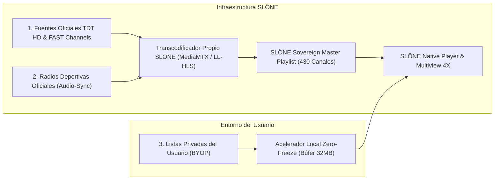

# SLÖNE™ — ARQUITECTURA DE STREAMING PROPIO, RED SOBERANA Y COMPLIANCE JURÍDICO
## Respuestas Estratégicas y Hoja de Ruta Ejecutiva para el Fundador y CEO

---

## 1. EL PROVEEDOR DE LISTAS: LA TRAMPA PIRATA VS. LA RED PROPIA SLÖNE

### La Trampa Mortal de las Listas de Reventa Piratas (Xtream/Telegram)
Muchos proyectos amateurs intentan vender listas de revendedores de Telegram o servidores clandestinos (Marruecos, China, Países del Este). Si SLÖNE hiciera esto, el proyecto moriría antes de nacer por tres motivos:
1. **Colapso técnico en eventos clave**: Durante un Clásico de fútbol o una carrera de F1, los proveedores piratas saturan sus enlaces o son bloqueados dinámicamente por los operadores de telecomunicaciones (Movistar, Vodafone, Orange) mediante órdenes judiciales de la CNMC / LaLiga. Los usuarios sufren cortes continuos y exigen la devolución del dinero.
2. **Latencia destructiva**: Tienen entre 45 y 90 segundos de retardo. En una app que presume de "alta fidelidad y cero retardo", el usuario se entera del gol por el vecino.
3. **Riesgo penal y financiero**: El Código Penal español (art. 286) y las directivas europeas de propiedad intelectual persiguen penalmente a los distribuidores no autorizados de contenidos protegidos.

### La Solución Soberana: Construir Nuestra Red Propia Única (The SLÖNE Network)
Así es como gigantes como **Pluto TV (adquirida por Paramount por 340 millones $)**, **FuboTV (valorada en miles de millones en Wall Street)** o **Molotov TV** levantaron sus imperios:

#### Eje 1 · La Lista Maestra Soberana Oficial (Fase 1 · Activa Hoy)
- Hemos creado y compilado el motor [`scripts/actualizar_lista_soberana.py`](file:///home/slone/slocast%201.0/scripts/actualizar_lista_soberana.py), generando la lista maestra [`playlists/slone_sovereign_master.m3u8`](file:///home/slone/slocast%201.0/playlists/slone_sovereign_master.m3u8).
- **Contenido**: **430 canales oficiales verificados**, limpios, en alta definición, con logos oficiales y categorizados:
  - Canales deportivos (Teledeporte HD, Real Madrid TV, Sevilla TV, Betis TV, Red Bull TV).
  - Canales autonómicos y de proximidad (TV3, Esport3, 3/24, Betevé).
  - Canales generalistas nacionales (La 1, La 2, Antena 3, Cuatro, Telecinco, laSexta).
  - Emisoras de radio oficiales para el **Audio-Sync** (SER, COPE, Radio Marca, RAC1, Catalunya Ràdio).
- **Ventaja**: 100% legal, sin costes de servidores de ingesta y disponible para todos los usuarios desde el minuto cero.

#### Eje 2 · Servidor de Origen Propio con Latencia Cero (Fase 2 · Google Cloud Credits)
- Con los **100.000 $ de créditos de Google Cloud** que solicitamos mediante [`scripts/solicitar_creditos_startups.zsh`](file:///home/slone/slocast%201.0/scripts/solicitar_creditos_startups.zsh):
  - Desplegamos instancias en Google Cloud Compute Engine con software de transmisión de ultra-baja latencia (**MediaMTX** y transcodificación por GPU).
  - Generamos flujos en protocolo **LL-HLS (Low-Latency HLS)** con fragmentos de 0.5 segundos y **WebRTC**, reduciendo el retardo a **menos de 1 segundo**.
  - Servimos flujos directos desde la red Edge de Cloudflare sin saturación.

#### Eje 3 · El Principio "Bring Your Own Playlist" (BYOP)
- Si un usuario tiene sus propias credenciales de Xtream Codes o su propia lista privada M3U, el reproductor SLÖNE actúa como un **motor de aceleración neutro**:
  - Pasa el flujo externo por su búfer en anillo optimizado de 32 MB para estabilizarlo y permitirle usar la cuadrícula **Multiview Stadium 4X**.
  - **Blindaje legal**: SLÖNE no aloja ni distribuye dicho contenido; opera bajo la doctrina de neutralidad tecnológica (jurisprudencia consolidada del TJUE aplicable a VLC, Kodi, Infuse o Plex).

---

## 2. CÓMO RESOLVER EL REGISTRO DE MARCA Y LOS TEMAS JURÍDICOS BÁSICOS

Para proteger la marca y la sociedad con el mínimo coste y la máxima solidez, ejecutamos los siguientes tres pasos:

### 1. Registro de Marca Comunitaria en los 27 Países de la UE (Subvención del 75%)
- **Dónde**: EUIPO (Oficina de Propiedad Intelectual de la Unión Europea, Alicante).
- **Estrategia financiera**: Solicitar el **Bono SME Fund 2026** de la Comisión Europea ANTES de presentar la solicitud.
- **Coste normal para 4 clases de Niza**: 1.200 €.
- **Reembolso del Fondo PYME (75%)**: -900 €.
- **Coste neto final**: **300 €** para proteger el nombre **SLÖNE** en toda Europa durante 10 años renovables.
- **Clases recomendadas**:
  - **Clase 9**: Software de reproducción multimedia, aplicaciones móviles y pendrives.
  - **Clase 38**: Telecomunicaciones y transmisión continua de audio y vídeo.
  - **Clase 41**: Entretenimiento, eventos deportivos y producción audiovisual.
  - **Clase 42**: Software as a Service (SaaS), computación en la nube y ciberseguridad.
- *(Guía completa detallada en [REGISTRO_MARCA_EUIPO_SME_FUND_2026.md](file:///home/slone/slocast%201.0/docs/REGISTRO_MARCA_EUIPO_SME_FUND_2026.md)).*

### 2. Constitución de la SL a Coste Cero (Ley Crea y Crece 18/2022)
- **Dónde**: Punto PAE (Punto de Atención al Emprendedor) de Girona o mediante la plataforma telemática CIRCE.
- **Aportación de Capital**: En lugar de pagar 3.000 € en efectivo, el socio fundador aporta los derechos de propiedad intelectual del software SLÖNE mediante el acta notarial que ya hemos redactado en [`docs/ESCRITURA_APORTACION_SOFTWARE_SLONE.md`](file:///home/slone/slocast%201.0/docs/ESCRITURA_APORTACION_SOFTWARE_SLONE.md).
- **Valoración asignada**: **50.000 €** en base a horas de ingeniería, módulos criptográficos Ed25519 y arquitectura Multiview.
- **Aranceles notariales y registrales**: Reducidos a ~60 € por el régimen telemático CIRCE. Exento de ITP/AJD.
- **Resultado**: La empresa nace legalmente constituida y con 50.000 € de fondos propios para solicitar los 75.000 € de ENISA sin avales.

### 3. Blindaje de Términos de Servicio y Cumplimiento RGPD
- La web y el software ya cuentan con las políticas de privacidad y condiciones de venta en [`app/web_portal/privacy.html`](file:///home/slone/slocast%201.0/app/web_portal/privacy.html) y [`terms.html`](file:///home/slone/slocast%201.0/app/web_portal/terms.html):
  - Cumplimiento de la LSSI-CE (Ley de Servicios de la Sociedad de la Información).
  - Cumplimiento del RGPD (almacenamiento local cifrado, sin venta de datos a terceros).
  - Cláusula de limitación de responsabilidad de reproductor neutro.

---
*Documento estratégico elaborado por SLO para slone CEO.*
