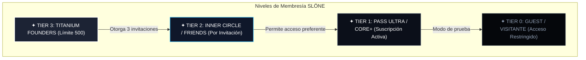

# SLÖNE · Estudio Estratégico de Nomenclatura & Membresías de Élite
*Documento de Estrategia Corporativa · Versión 1.0 Confidencial*  
*Autor: SLO (CTO de slone)*

---

## 1. Contexto & Filosofía de Marca
El ecosistema **SLÖNE** se define por la confluencia entre **sofisticación europea (diseño nórdico/suizo minimalista)** y **audacia tecnológica de Silicon Valley (Apple, Tesla, Stripe, Superhuman)**.

En un mercado saturado de suscripciones impersonales (Netflix, Prime, Spotify), SLÖNE no vende "una cuota mensual": vende **pertenencia a un círculo tecnológico restringido, calidad 4K/8K sin concesiones y soberanía de contenidos**.

---

## 2. Benchmark de Nomenclatura en la Industria de Élite

| Marca / Referente | Término Utilizado | Psicología del Consumidor | Lección para SLÖNE |
| :--- | :--- | :--- | :--- |
| **Tesla** | *Founders Series* | Adquisición anticipada a precio premium; sensación de financiar el futuro. | Enlace directo con los primeros 500 socios vitalicios. |
| **American Express** | *Centurion (Black Card)* | Metal pesado, numeración láser, solo por invitación. El estatus se valida físicamente. | La tarjeta metálica con NFC como llave física del ecosistema. |
| **Superhuman / Gmail early** | *Invite-Only / VIP Onboarding* | Escasez artificial radical. Quien está dentro siente que posee un privilegio inalcanzable. | El sistema de invitaciones entre iguales. |
| **Soho House / Zero Bond** | *Inner Circle / Committee Approved* | Pertenencia a un colectivo con valores y estilo compartidos. | Ideal para el tier de amigos, colaboradores y confianza. |
| **Apple** | *Titanium Natural / Pro Max* | Materialidad honesta, resistencia extrema, acabado satinado aeroespacial. | Uso del "Titanium" como adjetivo de solidez permanente. |

---

## 3. Arquitectura Propuesta de Niveles (Tiers SLÖNE)

### Detalle de Niveles:
1. **Nivel Vitalicio (Founders)**:
   - Pago único de entrada / Token de por vida.
   - Acceso sin límites a todos los desarrollos futuros (Smart TV, IPTV, servidores privados, IA, herramientas de trading/póker, apps nativas).
   - Tarjeta física numerada en titanio/acero cepillado con chip NFC de activación instantánea.
   - Asignación de 3 pases de invitación privada.
2. **Nivel Amigos y Colaboradores (Friends & Family / Inner Circle)**:
   - Solo accesible mediante código entregado por un Founder o slone directamente.
   - Acceso a versiones Alpha/Beta de software antes de su despliegue general.
   - Canales directos de feedback y peticiones de funcionalidades a medida.
3. **Nivel Suscriptor Comercial (Pass Ultra)**:
   - Cuota mensual/anual recurrente.
   - Servicios de transmisión deportiva en directo 4K, SmartTube sin anuncios, multiview y reproductor integrado.

---

## 4. Las 5 Encuestas Estratégicas de Decisión

### Encuesta 1 · Nivel Élite / Vitalicio (Tier 500)
- **Opción A (Recomendada)**: `SLÖNE Titanium Founders` (Prestigio tangible, material noble y homenaje a los pioneros).
- **Opción B**: `SLÖNE Syndicate 500` (Enfoque club privado de inversión y vanguardia técnica).
- **Opción C**: `SLÖNE Genesis Circle` (Énfasis en la primera generación y linaje original).
- **Opción D**: `SLÖNE Black Guild` (Misterio y sobriedad absoluta, estilo Amex Centurion).

### Encuesta 2 · Nivel Confianza / Círculo Cercano (Tier Friends)
- **Opción A (Recomendada)**: `SLÖNE Inner Circle` (Transmite exclusividad orgánica y reserva).
- **Opción B**: `SLÖNE Friends & Family` (Transparente, cálido y utilizado por las mejores startups de Silicon Valley).
- **Opción C**: `SLÖNE Private Patron` (Para mecenas y colaboradores estrechos).
- **Opción D**: `SLÖNE Alpha Cohort` (Enfoque puramente técnico e innovador).

### Encuesta 3 · Nivel Público / Suscripción Televisión y Streaming
- **Opción A (Recomendada)**: `SLÖNE Pass Ultra` (Elegante, directo, centrado en el beneficio 4K y directos).
- **Opción B**: `SLÖNE Obsidian` (Alineado con la interfaz oscura y el lujo austero).
- **Opción C**: `SLÖNE Prime Access` (Percepción de máxima prioridad y cero esperas).
- **Opción D**: `SLÖNE Core+` (Minimalismo nórdico radical).

### Encuesta 4 · El Objeto Físico de Acceso (Hardware Token)
- **Opción A (Recomendada)**: `SLÖNE Metal Keycard` (Tarjeta en acero inoxidable y titanio mate con NFC grabado por láser).
- **Opción B**: `SLÖNE Titanium Bar` (Mini lingote de precisión de 45g con chip NFC).
- **Opción C**: `SLÖNE Carbon Token` (Moneda táctil en fibra de carbono mate con código criptográfico).
- **Opción D**: `SLÖNE Smart Signet` (Anillo inteligente de titanio con protocolo FIDO2/NFC).

### Encuesta 5 · Táctica de Despliegue en Sigilo (Stealth Launch)
- **Opción A (Recomendada)**: `Mecanismo por Invitación Restringida` (Cada socio Founder recibe 3 invitaciones físicas con NFC para incorporar a amigos selectos).
- **Opción B**: `Entrega en Mano Exclusiva` (Las tarjetas solo se entregan físicamente en persona; no existe pasarela pública en internet).
- **Opción C**: `Drops Mensuales Limitados` (Lotes de 50 accesos cada mes con cuenta atrás silenciosa).
- **Opción D**: `Manifiesto Cifrado Web` (Página web de una sola línea negra con campo para clave criptográfica).

---

## 5. Próximos Pasos de Ejecución
1. **Recoger tu veredicto** en las 5 encuestas.
2. **Generar la identidad visual del Tier ganador** (mockups de la tarjeta metálica física y credenciales digitales).
3. **Integrar el módulo de autenticación de pases** en el launcher de la Smart TV y portal web.
