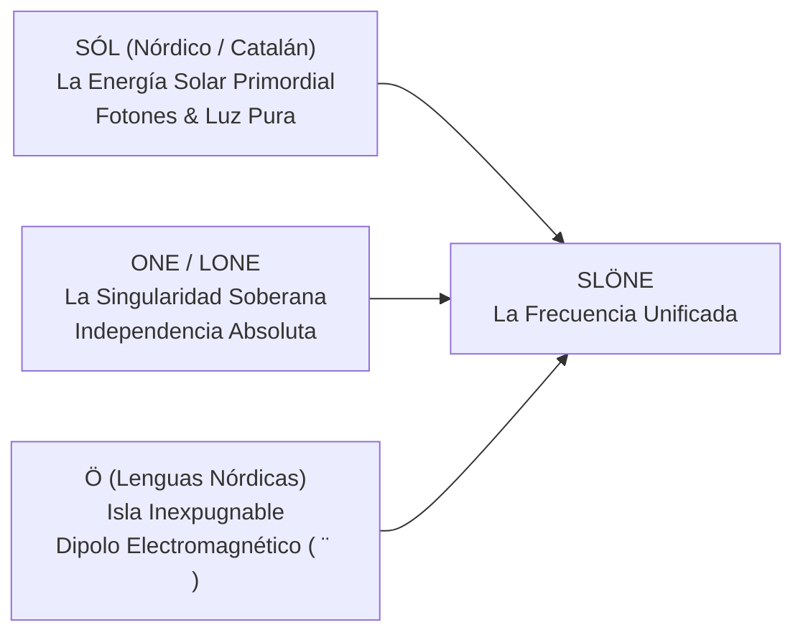

# MANIFIESTO DE IDENTIDAD & COSMOLOGÍA DE MARCA · SLÖNE
### De la Física de Ondas y el Mito de Bluetooth a la Soberanía Tecnológica
*Documento Estratégico Maestro · Dirección de Marca & Tecnología*  
*Autor: SLO (CTO de slone)*

---

## 1. El Paradigma Bluetooth: Cómo Nace un Mito Tecnológico
En 1997, Intel, Ericsson y Nokia se enfrentaban a una guerra de protocolos inalámbricos incompatibles. Jim Kardach, ingeniero jefe de Intel, acababa de leer sobre **Harald Blåtand (Harald Bluetooth)**, el rey vikingo que logró lo que parecía imposible: **unir a las tribus dispersas de Dinamarca y Noruega bajo una sola corona**.

Kardach propuso el nombre como código interno provisional:
> *"Harald unió Escandinavia; nuestro estándar unirá los ordenadores y los teléfonos móviles con un enlace de radio de corto alcance."*

El logotipo no fue diseñado por una agencia de marketing al uso; se forjó fundiendo dos runas del **Futhark Joven**:
* **ᚼ (Hagall)**: El granizo, la fuerza elemental de la naturaleza y la inicial 'H'.
* **ᛒ (Bjarkan)**: El abedul, el renacimiento, la primavera y la inicial 'B'.

La unión de ambas runas dio lugar a la **bindrune (runa ligada)** más famosa del planeta. Su color azul cobalto no representaba el mar, sino el tono oscuro que le atribuían a los dientes del rey.

**La lección para SLÖNE es rotunda**: Las marcas legendarias de tecnología no inventan eslóganes vacíos; **reivindican un elemento real de la naturaleza, un mito de unificación y una verdad física incontestable**.

---

## 2. La Verdad Física de SLÖNE: ¿Qué Vendemos Realmente?

En la superficie, parecería que creamos un reproductor de TV, un launcher o un agregador de streams deportivos. **Eso es solo la interfaz de usuario.**

En el fondo de la física y la arquitectura de sistemas, SLÖNE ofrece tres pilares elementales:

```
                  ┌────────────────────────────────────────┐
                  │          EL ECOSISTEMA SLÖNE           │
                  └───────────────────┬────────────────────┘
                                      │
            ┌─────────────────────────┼─────────────────────────┐
            ▼                         ▼                         ▼
   1. CONECTIVIDAD PURA      2. FILTRADO ENTROPÍA     3. SUPERCONDUCTIVIDAD
   Unificación sin cables   Eliminación radical del  Resistencia cero en la
   ni intermediarios entre   ruido publicitario y el  transmisión (ThinkPad a
  portátil, TV y teléfono.  rastreo de datos ajeno.  Xiaomi TV en 4K 60 FPS).
```

### A. Conectividad Soberana (El Hilo Invisible)
Vivimos en un entorno donde para enviar una señal de vídeo desde un ThinkPad X390 a una televisión Xiaomi en la misma habitación (192.168.1.0/24), las grandes corporaciones exigen pasar por sus servidores en California, loguearse con cuentas extractivas y tragarse 30 segundos de anuncios comerciales.
* **SLÖNE destruye esa intermediación**.
* Es un **túnel directo de radiofrecuencia y socket local**. La señal viaja de máquina a máquina sin pedir permiso a nadie. Es la unificación de los dispositivos de slone bajo una sola frecuencia soberana.

### B. Descontaminación del Espectro (Anti-Entropía)
La publicidad en una pantalla de salón o en una mesa de póker no es solo una molestia estética: **en términos de termodinámica e información, es ruido puro (entropía)**. Consume ciclos de CPU de la tele, satura el buffer de red y fatiga la visión del usuario.
* SLÖNE actúa como un **filtro pasa-banda cuántico**: deja pasar la señal pura (el balón rodando en 4K UHD, la narración en directo de Joan Maria Pou, la carta del river en Winamax) y aniquila todo el ruido circundante.

### C. Resonancia Armónica (El Circuito Cerrado)
Cuando dos circuitos sintonizan exactamente la misma frecuencia de oscilación, la transferencia de energía se produce con **rendimiento máximo y pérdida mínima**.
* SLÖNE sintoniza tus dispositivos en fase. Tu terminal ZSH, tu televisión y tu teléfono vibran en el mismo canal cifrado.

---

## 3. Etimología, Heráldica y Cosmología de SLÖNE

¿De dónde nace el nombre y cuál es su geometría sagrada?



### 1. La Raíz `SÓL`: La Energía Primordial
* En nórdico antiguo y en nuestra propia lengua materna, *Sól* es el astro rey, el generador de toda la energía visible y la fuente de los fotones que iluminan un panel OLED o LED.
* Representa el **fuego emisor**, la potencia de cálculo bruta que procesa el flujo audiovisual.

### 2. La Raíz `ONE`: La Unidad Indivisible
* Frente a la dispersión de diez aplicaciones distintas que fallan y compiten entre sí, SLÖNE representa el **Uno**: una única plataforma, un único mando, una experiencia unificada sin costuras.

### 3. La Diéresis `Ö`: La Isla Soberana y el Dipolo de Resonancia
En la grafía nórdica, la letra **Ö** (u **Ø**) denota una **isla** (como en *Tromsø*, *Malmö* o *Fårö*). Tu ecosistema tecnológico es tu isla personal: ningún algoritmo corporativo puede invadirla.

A nivel de física de partículas y electromagnetismo:
* El círculo `O` representa el **campo cerrado** (la órbita cuántica o la espira de inducción).
* Los dos puntos de la diéresis `¨` representan los **dos polos de un dipolo electromagnético** (ánodo y cátodo, emisor y receptor, la máquina local y la pantalla).
* Cuando los dos polos están presentes, **la corriente fluye**.

### 4. El Símbolo Gráfico: La Runa Sowilo (ᛋ) y la Onda Sinusoidal
El monograma oficial de SLÖNE nace de entrelazar la onda senoidal pura de la corriente alterna (la letra **S**) con el núcleo dipolar (**Ö**). 
* Es la representación gráfica de una **onda portadora de alta energía atravesando un núcleo cerrado**.

---

## 4. Reestructuración de Membresías: Arquitectura de Estados de la Materia

Abandonamos las etiquetas trilladas del marketing genérico anglosajón (*"VIP"*, *"Pro"*, *"Platinum"*). En SLÖNE, cada nivel de pertenencia encarna un **estado de energía y física de transmisión**:

```
      ▲
     ╱ ╲     ✦ TIER 3: SLÖNE SUPERCONDUCTOR 500 (Resistencia Cero · Vitalicio)
    ╱   ╲    
   ╱─────╲   ✦ TIER 2: SLÖNE RESONANCE (Amigos & Red por Sintonía · Invite-Only)
  ╱       ╲  
 ╱─────────╲ ✦ TIER 1: SLÖNE FLUX (Flujo Continuo · Transmisión 4K Deportes)
╱───────────╲
─────────────────────────────────────────────────────────────────────────
             ✦ TIER 0: SLÖNE GROUND (Frecuencia Base · Modo Local Desconectado)
```

### Nivel 0 · SLÖNE Ground (Toma de Tierra)
* **Concepto**: El potencial cero de referencia.
* **Función**: Software base de código abierto o local en la máquina, sin servicios de nube ni transmisión en vivo remota. Privacidad pura, ejecución local en terminal.

### Nivel 1 · SLÖNE Flux (Flujo Cuántico / Corriente Viva)
* **Concepto**: El movimiento continuo de electrones a lo largo del conductor.
* **Función**: La suscripción comercial activa para streaming. Emisión ininterrumpida de fútbol en 4K UHD, audio sincronizado de radio al milisegundo y SmartTube sin fricción publicitaria.
* **Mensaje**: *"Sintoniza el flujo sin cortes."*

### Nivel 2 · SLÖNE Resonance / Harmonic Circle (Círculo de Resonancia)
* **Concepto**: Fenómeno físico donde dos sistemas oscilan al unísono con mínima disipación.
* **Función**: Acceso restringido para el círculo de confianza (Friends & Family, colaboradores y probadores de élite). Solo accesible mediante sintonía directa con un miembro fundador.
* **Mensaje**: *"Para quienes vibran en nuestra misma frecuencia."*

### Nivel 3 · SLÖNE Superconductor 500 / Titanium Core (Resistencia Cero)
* **Concepto**: La superconductividad es el estado cuántico más noble de la materia: a temperatura crítica, la resistencia eléctrica cae exactamente a **CERO**. La corriente eléctrica puede circular eternamente sin perder un solo julio de energía.
* **Función**: Los 500 socios vitalicios fundadores. Pase permanente de por vida a toda la tecnología presente y futura de la corporación.
* **El Objeto Físico**: Una tarjeta forjada en **Titanio Grado 5** (aleación Ti-6Al-4V de uso aeroespacial) con bobina de resonancia electromagnética NFC integrada y número de serie grabado por micro-ablación láser (`001/500` a `500/500`).
* **Mensaje**: *"Resistencia cero. Conectividad perpetua."*

---

## 5. Las 5 Nuevas Encuestas Estratégicas Profundas

Ahora que los cimientos están enraizados en la física de ondas, la energía y la tradición mitológica de la conectividad (al igual que Bluetooth):

---

### Encuesta 1 · El Nombre del Nivel Vitalicio (500 Socios Máximos)
¿Qué denominación encapsula mejor el poder de la energía infinita y el metal noble?
* **A (Recomendada)**: `SLÖNE Superconductor 500` (Resistencia eléctrica cero; energía y fidelidad perpetuas de por vida).
* **B**: `SLÖNE Titanium Core` (El núcleo duro forjado en metal indestructible).
* **C**: `SLÖNE Genesis Dipole` (Los primeros 500 polos que generaron el campo electromagnético del proyecto).
* **D**: `SLÖNE Sol-Prime 500` (La primera emisión de radiación pura del ecosistema).

---

### Encuesta 2 · La Membresía de Confianza (Friends & Family)
¿Cómo nombrar al círculo cercano de amigos e invitados de honor sin caer en clichés de oficina?
* **A (Recomendada)**: `SLÖNE Resonance Circle` (Quienes están sintonizados en la misma frecuencia armónica de slone).
* **B**: `SLÖNE Harmonics` (Las frecuencias complementarias que enriquecen la señal principal).
* **C**: `SLÖNE Kinetic Alliance` (Socios activos en movimiento que impulsan el ecosistema).
* **D**: `SLÖNE Inner Frequency` (El canal privado de baja frecuencia inaudible para el exterior).

---

### Encuesta 3 · El Servicio Comercial de Streaming & Smart TV
¿Cuál debe ser el término para la suscripción activa de directos y contenido 4K?
* **A (Recomendada)**: `SLÖNE Flux Ultra` (El flujo ininterrumpido de señal deportiva y datos puros a 60 FPS).
* **B**: `SLÖNE Waveform 4K` (La onda pura sin compresión destructiva).
* **C**: `SLÖNE Radiant Pass` (Luz y señal de máxima luminiscencia sin sombras de anuncios).
* **D**: `SLÖNE Pulse` (El pulso vital que mantiene la televisión despierta y sincronizada).

---

### Encuesta 4 · El Token Físico (El Objeto de Poder)
Al igual que las runas grabadas en piedra o el metal pesado de las llaves maestras:
* **A (Recomendada)**: `SLÖNE Titanium Keycard (Ti-6Al-4V)` — Tarjeta metálica de titanio cepillado con antena toroidal de cobre incrustada que reacciona magnéticamente al acercarla al teléfono o mando de la tele.
* **B**: `SLÖNE Obsidian Monolith` — Bloque táctil de cristal volcánico negro pulido con chip criptográfico en el centro.
* **C**: `SLÖNE Resonant Tag` — Llavero o ficha de titanio mecanizado por CNC con código QR grabado por láser visible solo bajo luz ultravioleta.
* **D**: `SLÖNE Toroid Ring` — Anillo de titanio con tecnología de campo cercano para emparejar pantallas con un solo gesto.

---

### Encuesta 5 · La Revelación Silenciosa (Stealth Transmission)
¿Cómo encendemos la red SLÖNE en secreto emulando la propagación de una onda de radio?
* **A (Recomendada)**: `Propagación por Inducción (Pases por Resonancia)` — Cada socio Superconductor recibe físicamente 3 tarjetas "nodo" en titanio/acero para activar a sus personas de máxima confianza. La red solo crece por contacto directo.
* **B**: `Transmisión de Frecuencia Cifrada` — Una web que emite una frecuencia acústica de 432 Hz y una onda visual en negro puro. Solo quien introduce una clave de un solo uso desbloquea la pantalla de acceso.
* **C**: `Drop Físico a Puerta Cerrada` — Los primeros 50 lotes se entregan en mano en estuches de aluminio lacado con instrucciones mecanografiadas en papel de alto gramaje.
* **D**: `El Enlace Fantasma (Phantom Node)` — La aplicación se propaga de tele en tele en la red local mediante mDNS y Zero-Conf, como un pulso silencioso que se descubre al buscar dispositivos en la sala.

---

## 6. Conclusión de Arquitectura
El caso de Bluetooth demostró que unificar dispositivos dispersos requiere un relato que conecte la historia humana con la física de la comunicación. 

**SLÖNE no es una aplicación más: es la frecuencia soberana que elimina el ruido del mundo para devolverle al usuario el control absoluto de su energía y su tiempo.**
