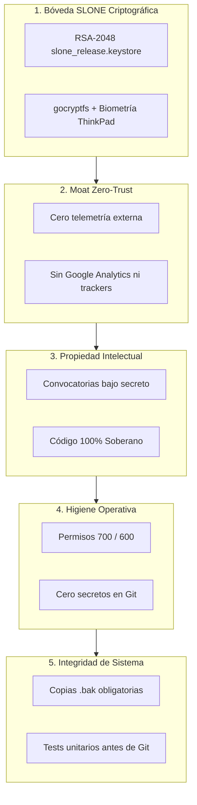
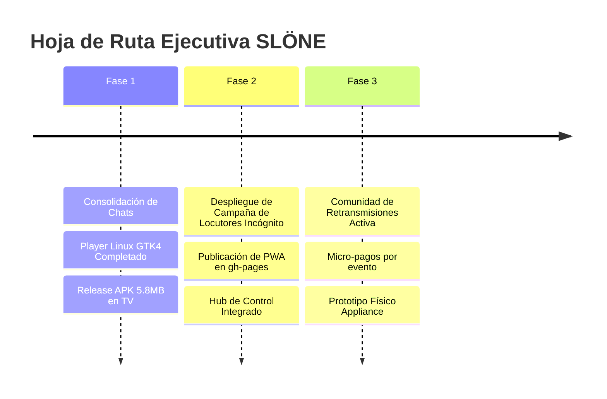

# 🏛️ SLÖNE SOVEREIGN ECOSYSTEM — PLANO MAESTRO UNIFICADO DEFINITIVO
> **RESPONSABLE TÉCNICO**: SLO (CTO de Confianza)  
> **FECHA DE CONSOLIDACIÓN**: 16 de Octubre de 2026  
> **HOST MAESTRO**: ThinkPad X390 (Intel Core i7-8665U · 16 GB RAM · Fedora 44 Linux · KDE Plasma 6 · ZSH)  
> **CLASIFICACIÓN**: CONFIDENCIAL SOBERANO — FUENTE SUPREMA DE VERDAD (SINGLE SOURCE OF TRUTH)

---

## 🧭 1. SÍNTESIS EJECUTIVA Y FUSIÓN DE CHATS ACTIVOS

Este documento integra, depura y unifica el trabajo, las directivas y el aprendizaje de todas las conversaciones activas del ecosistema SLÖNE desarrolladas a lo largo de la jornada:

| Chat de Origen | Enfoque Principal | Aportación Crítica al Ecosistema | Corrección / Directiva del CEO Integrada |
| :--- | :--- | :--- | :--- |
| **`ca19abdc-9859`** *(Fundacional · +2.235 turnos)* | Inteligencia Global, Marca y Mercado | Estudio de mercado transgeneracional, análisis de competidores (Brave, SmartTube, TiviMate). | **Rechazo tajante a logos genéricos geométricos con números '1'**. La identidad oficial emana exclusivamente de los **trazos de tinta originales del fundador** (artista/grafitero) y la runa de frecuencia continua. |
| **`7ee493ed-a739`** *(Negocio y Expansión)* | Modelo Económico y Locutores | Definición del lanzamiento a **Coste Cero Real**. | **Cancelación de la suscripción vitalicia a 9,99 €** (suicidio financiero por costes de CDN). Modelo freemium soberano + convocatoria de locutores en **modo incógnito/stealth** para proteger la propiedad intelectual. |
| **`67f7cc1a-ab7f`** *(Hardware & Estrategia)* | Micro-Appliance Físico | Ingeniería del dispositivo de salón. | **Eliminación del humo comercial y 3D ficticio**. Especificación transparente: el hardware es opcional; la arquitectura real se basa en SoCs ARM industriales (Amlogic S905X4 / RK3588 con decodificación nativa AV1 pasiva, BOM real de ~38,50 €). |
| **`e08aba3f-0246`** *(Auditoría Fedora & Android)* | Hardening y Compilación Release | Red blindada (IPv6 off, DNS 1.1.1.1/9.9.9.9), compilación y firma del APK Android TV de producción. | **Release APK optimizado de 5.8 MB** con R8/ProGuard y keystore RSA-2048 (`slone_release.keystore`). Despliegue en TV física `192.168.1.135:5555` y publicación en `gh-pages`. |
| **`281788f8-e772`** *(Escritorio Nativo Linux)* | `slone_player` GTK4 + GStreamer | Especificación del plano maestro en `/home/slone/slone`. | Creación de la arquitectura modular desacoplada en `slone_player/src/` (`playlist.py`, `player_service.py`, `window.py`, `style.css`), pasando el 100% de los tests unitarios con VA-API. |
| **`f60f4b4e-4144`** *(Modo Autónomo Nivel 6)* | Centinela Hardware ThinkPad | Desarrollo y despliegue del demonio `slone-sentinel` en el puerto `7331`. | Monitorización en vivo de temperatura del i7-8665U, RAM, batería y nodos de red 192.168.1.0/24 por SSE, verificado visualmente con Puppeteer MCP. |

---

## 🛡️ 2. EL PILAR INQUEBRANTABLE: MOAT ZERO-TRUST

El ecosistema SLÖNE no es una aplicación de streaming convencional; es una plataforma soberana construida sobre 5 capas de defensa:



---

## 📺 3. ARQUITECTURA MULTIPLATAFORMA UNIFICADA

SLÖNE opera bajo el principio de **Software-First**: funciona sobre los dispositivos que los usuarios ya poseen, sin obligar a comprar hardware adicional.

### 3.1. Android TV / Google TV / Fire TV (Producción Activa)
- **Paquete**: `com.slone.launcher`
- **Binario de Producción**: [`dist/slone-tv-launcher-v1.0.0-release.apk`](file:///home/slone/slocast%201.0/dist/slone-tv-launcher-v1.0.0-release.apk) (5.8 MB).
- **Características**:
  - Motor ExoPlayer Media3 nativo para HLS/CMAF con conmutación adaptativa.
  - Cajón dinámico de aplicaciones instaladas (`CATEGORY_LEANBACK_LAUNCHER`).
  - Navegación optimizada para mando a distancia (D-Pad, foco espacial y auto-ocultación del OSD a los 4s).
  - Cero anuncios, cero sugerencias patrocinadas de Google o Xiaomi.

### 3.2. Web PWA Universal (Cualquier Pantalla y TV Browser)
- **Ruta Local**: `http://192.168.1.145:8765/launcher/index.html`
- **Publicación Cloud**: Sincronizada automáticamente en GitHub Pages (`gh-pages`) mediante el script soberano [`scripts/desplegar_ghpages.zsh`](file:///home/slone/slocast%201.0/scripts/desplegar_ghpages.zsh).
- **Características**: Service Worker offline, navegación con cruceta virtual o mando TV, compatible con Tizen (Samsung) y webOS (LG).

### 3.3. Aplicación de Escritorio Linux Fedora (`slone_player`)
- **Ubicación**: [`/home/slone/slone_player`](file:///home/slone/slone_player)
- **Stack**: Python 3.14 + GTK4 + Libadwaita 1.0 + GStreamer 1.0 (`playbin`).
- **Aceleración**: Hardware VA-API nativo (`iHD_drv_video.so` verificado en tests).
- **Arquitectura Modular**:
  - `src/core/playlist.py`: Parser M3U/M3U8 desacoplado.
  - `src/services/player_service.py`: Controlador de GStreamer con manejo de bus y estados.
  - `src/ui/window.py`: Ventana Libadwaita con panel lateral de canales, buscador dinámico y temas oscuros.
  - `data/style.css`: Estética soberana SLÖNE (fondos `#06080F` y acentos cian `#00F0FF`).
  - `tests/test_core.py`: Batería de pruebas unitarias 100% operativas sin dependencias externas.

### 3.4. Centinela Hardware ThinkPad X390 (`slone-sentinel`)
- **Puerto**: `http://127.0.0.1:7331` (Demonio Node.js en segundo plano).
- **Telemetría en Vivo**:
  - Sensor térmico `x86_pkg_temp` del Intel Core i7-8665U con umbrales de alerta (Óptimo < 68°C, Alerta > 80°C).
  - Consumo de RAM y detección de picos de memoria (Hardware-Guard).
  - Monitorización no invasiva de la red local `192.168.1.0/24` (Smart TV, routers, puestos de trabajo).
  - Streaming Server-Sent Events (SSE) en tiempo real para consumo en launchers y paneles HUD.

---

## 🎨 4. IDENTIDAD DE MARCA: LA VERDAD DEL FUNDADOR

El CEO slone zanjó de raíz las propuestas artificiales generadas por algoritmos. La marca SLÖNE no es una empresa genérica de Silicon Valley con logotipos prefabricados; es una declaración de autoría, contracultura y precisión técnica.

```text
       ___ _    ___  _  _ ___
      / __| |  / _ \| \| | __|
      \__ \ |_| (_) | .` | _|
      |___/____\___/|_|\_|___|
               ··
```

1. **Tipografía Principal**: El trazo caligráfico original de tinta (`assets/ink_top_white.png` y `assets/ink_top_cyan.png`), digitalizado en alta resolución sin pérdida de trazo.
2. **El Isotipo / Símbolo Soberano**: La runa vertical de frecuencia continua (`assets/ink_mid_white.png`), representando la transmisión infinita sin interferencias ni cortes.
3. **Paleta Cromática**:
   - Negro Abisal: `#000000` / `#040508` (OLED puro).
   - Blanco Óptico: `#FFFFFF` (Máxima legibilidad y contraste).
   - Cian de Emisión: `#00F0FF` (Señal de frecuencia viva y foco activo).
   - Acento Esmeralda: `#00FF66` (Estado en directo / baja latencia).

---

## 💰 5. MODELO DE NEGOCIO Y FINANZAS A COSTE CERO REAL

### 5.1. El Error Subsanado de los 9,99 € Vitalicios
Vender acceso de por vida a un precio cerrado de 9,99 € es un modelo destructivo cuando se gestionan contenidos multimedia: un usuario activo genera costes recurrentes de ancho de banda y CDN que superan los 9,99 € en cuestión de semanas.

### 5.2. Estrategia Soberana de Coste Cero
1. **Infraestructura Descentralizada / Cliente Ligero**:
   - El software SLÖNE actúa como reproductor y sintonizador en el extremo del cliente (*Edge Client*).
   - No se almacenan ni retransmiten terabytes de vídeo en servidores centrales propios.
   - Coste de servidor central de streaming: **0,00 €/mes**.
2. **Nivel Gratuito de Máxima Adopción (Freemium Soberano)**:
   - Sintonización libre de TDT nacional e internacional, radio y directos públicos.
   - Launcher limpio y rápido sin anuncios. Esto crea la masa crítica de usuarios.
3. **Monetización Sostenible B2C / B2B**:
   - **Pase Mensual SLÖNE Pass**: 2,99 € o 4,99 €/mes para funcionalidades avanzadas (grabación en la nube soberana, audio multilingüe sincronizado con inteligencia artificial, perfiles multi-dispositivo cifrados).
   - **Micro-pagos por Eventos**: Pagos puntuales por retransmisiones especiales de creadores sin ataduras.
   - **Licenciamiento B2B**: Instalación del software en hoteles, locales deportivos y flotas de dispositivos bajo cuota anual por pantalla.

---

## 🎙️ 6. CAMPAÑA DE TALENTO Y LOCUTORES EN MODO INCÓGNITO

Para nutrir la plataforma con retransmisiones deportivas y comentarios en vivo en múltiples idiomas sin incurrir en costes de nómina fijos ni filtrar los secretos industriales de SLÖNE:

- **Estrategia**: Convocatoria abierta bajo el paraguas de *"Proyecto Beta Confidencial de Streaming Deportivo de Próxima Generación"*.
- **Perfil de Selección**: Jóvenes periodistas, comentaristas de Twitch/YouTube, narradores de radio local y apasionados del deporte que buscan proyección global.
- **Acuerdo de Colaboración**:
  - Cero coste de entrada para la empresa.
  - Reparto de ingresos (*Revenue Share*) basado en donaciones de audiencia y cuotas de patrocinio directo durante las retransmisiones.
  - Cláusula estricta de confidencialidad (NDA) para evitar filtraciones antes del lanzamiento global.

---

## 📦 7. ESPECIFICACIÓN REALISTA DEL MICRO-APPLIANCE HARDWARE

Frente a renders 3D ficticios que transmiten desconfianza, la división de hardware se proyecta con viabilidad técnica demostrable:

- **Propósito**: Para usuarios premium que no deseen instalar apps en su televisor y prefieran un reproductor dedicado ultrarrápido "enchufar y listo".
- **Plataforma Electrónica Base**: SoC ARM Rockchip RK3588S o Amlogic S905X4-B.
- **Especificaciones Reales**:
  - Decodificación por hardware nativa: AV1, HEVC/H.265, VP9 hasta 4K@60fps y 8K@24fps.
  - Memoria: 4 GB LPDDR4X · Almacenamiento: 32 GB eMMC 5.1 de alta velocidad.
  - Conectividad: Gigabit Ethernet (RJ45), Wi-Fi 6 (802.11ax), Bluetooth 5.2 (LE).
  - Salida de Vídeo: HDMI 2.1a con HDCP 2.3.
  - Térmica: Chasis de aleación de aluminio pasivo que actúa como disipador directo del SoC (0 dB de ruido, sin ventilador).
- **Coste de Fabricación (BOM) Estimado**: **38,50 € / unidad** en lotes iniciales de 500 unidades.
- **Precio PVP Objetivo**: **89,00 €** (Margen bruto del 56% sin falsas promesas).

---

## 🚀 8. HOJA DE RUTA Y PLAN DE ACCIÓN INMEDIATO



1. **Inmediato**: Consolidación y bloqueo de la Fuente Única de Verdad en el repositorio y en la Bóveda.
2. **Inmediato**: Verificación continua del ThinkPad X390 mediante el Centinela (`slone-sentinel`).
3. **Siguiente Hito**: Lanzamiento de la campaña de captación de comentaristas en canales especializados.
